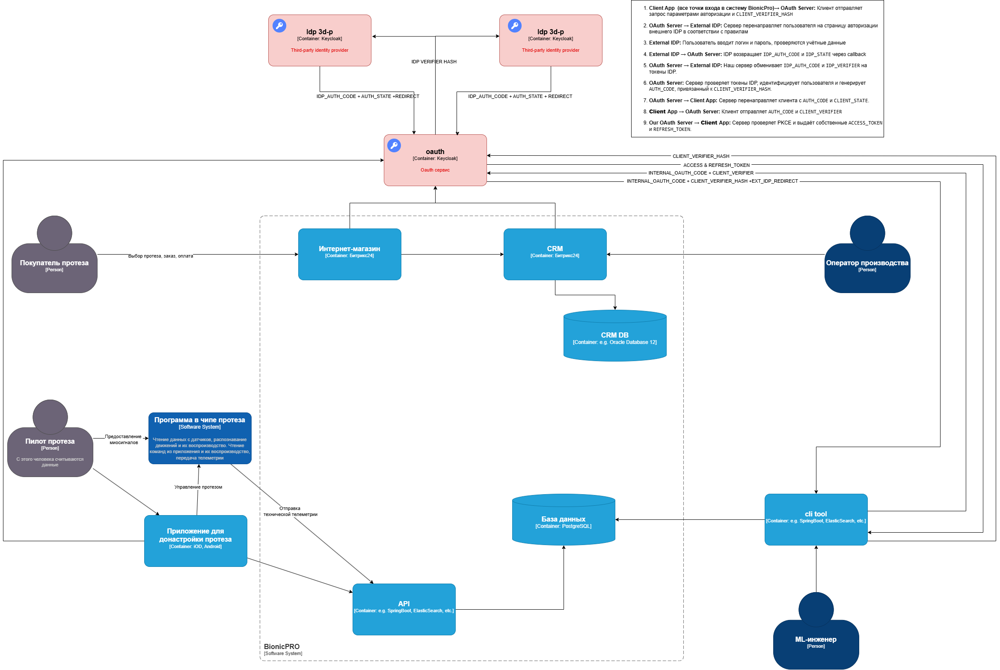
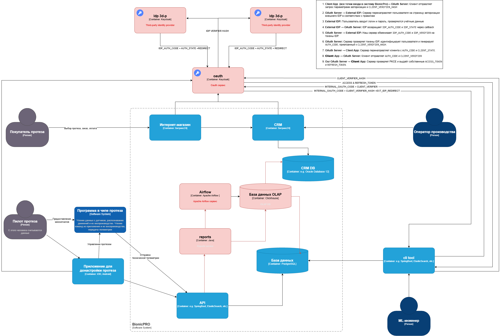

Задание 1
1) Диаграмма внедрение PKCE

Задание 2
1) Диаграмма архитектуры системы сбора отчетов

**Запуск системы**
 - Запустить docker-compose.yml из корня проекта
 - Перейти http://localhost:8081/ (admin/admin) запустить DAG
 - Перейти http://localhost:3000/ (например user1/password123) и сгенерировать отчет. Даты отчетов можно не выбирать